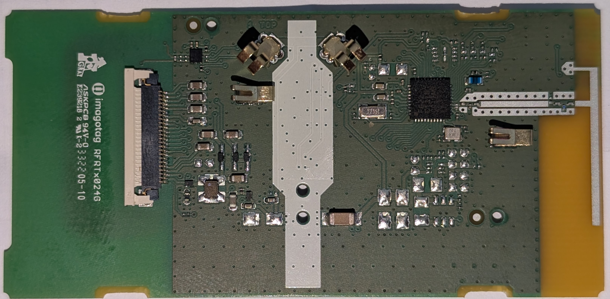
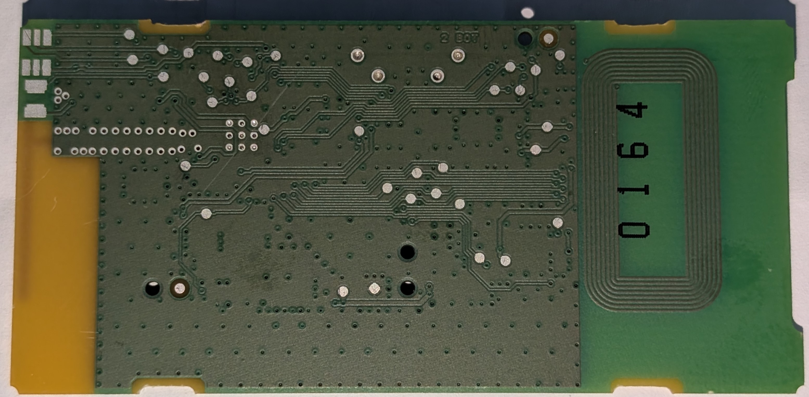
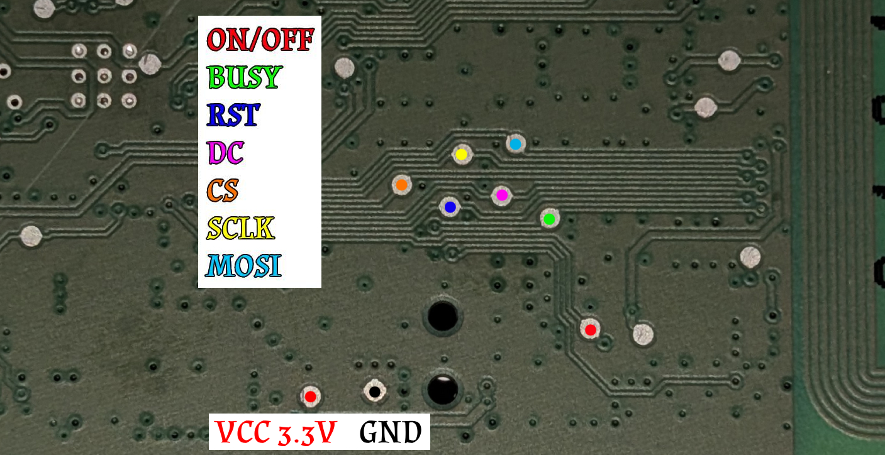
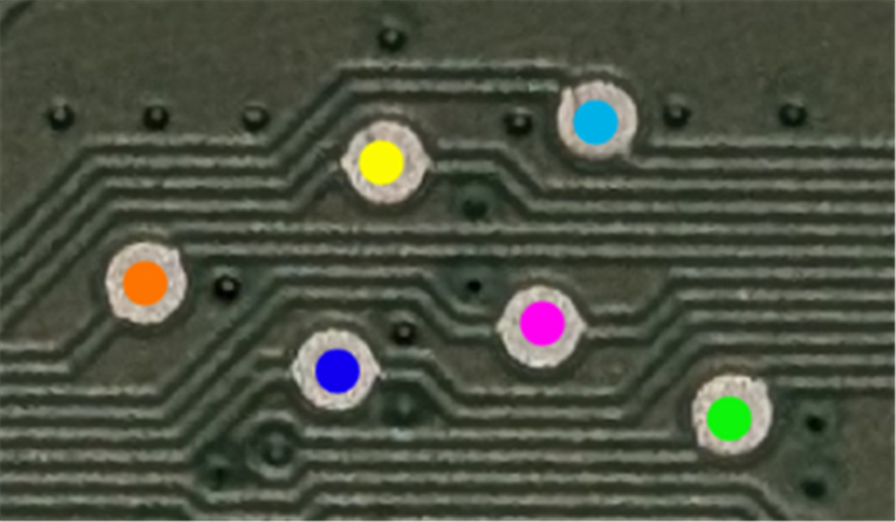
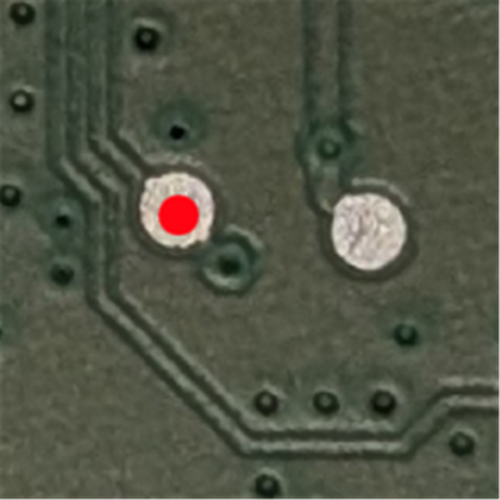

# Референсные фото

| | |
| --- | --- |
| Источник | [shanislav/GxEPD2_PervasiveDisplays](https://github.com/shanislav/GxEPD2_PervasiveDisplays), папка `docs/` |
| Автор | shanislav (Shano) |
| Изменения | файлы переименованы; `zoom-onoff.png` и `zoom-signals.png` — увеличенные вырезки из `testpoints26.jpg`, сделанные здесь |

## Плата, лицевая сторона

Разъём шлейфа экрана слева, чип справа.

`board26_front.jpg`

## Плата, оборот

Катушка антенны и батарейный отсек. Ориентация повёрнута на 180° относительно наших снимков.

`board26_back.jpg`

## Тестовые площадки

Увеличенный участок оборота с подписанными площадками: шесть сигналов экрана и отдельная площадка ON/OFF ключа питания панели.

`testpoints26.jpg`

### Вырезка: сигналы экрана

Шесть площадок на шести дорожках, которые идут общей шиной к левому краю чипа: CS, SCLK, MOSI (SDA), RST, DC и BUSY. На референсе шестая подписана как BUSY, но на нашей плате эта линия (PC06, нога 7) оказалась ключом питания панели.

`zoom-signals.png`

### Вырезка: ON/OFF

Отдельная площадка ON/OFF — затвор MOSFET питания панели (низкий уровень = панель включена). Из неё выходит одна дорожка, в шину сигналов она не входит.

`zoom-onoff.png`

---

*English:* reference photos of the same board model (not our unit) from [shanislav/GxEPD2_PervasiveDisplays](https://github.com/shanislav/GxEPD2_PervasiveDisplays) (`docs/`), by shanislav (Shano), licensed under [GPL-3.0](https://github.com/shanislav/GxEPD2_PervasiveDisplays/blob/main/LICENSE). Files were renamed; `zoom-onoff.png` and `zoom-signals.png` are enlarged crops of `testpoints26.jpg` made here.
